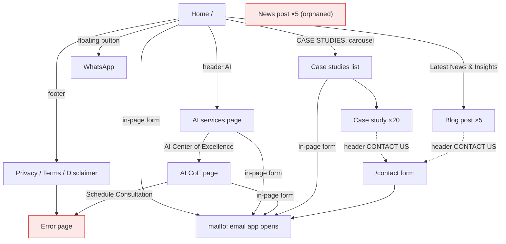
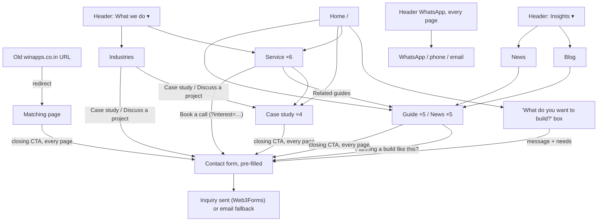

# Page journeys: winapps.co.in → this site

Feedback on the new site was that some page flows from the live site were missing. This document maps every page and journey on **www.winapps.co.in**, shows where each one now lives on this site, and lists what still needs input from Winapps.

**Source:** a crawl of the live site on 2026-10-26: 51 URLs, 69 screenshots, every link, button, form field and interactive state. It lives in `_sitemap-capture/` on the machine that ran it; it's excluded from the repo (66 MB). **Status key:** ✅ covered · ➕ added in this change · ↪ redirected · ⏸ needs Winapps input · ✖ intentionally dropped.

---

## 1. What we found on the live site

1. **Every journey ends at an email draft or an external link.** All four enquiry forms open `mailto:sales@winapps.co.in`; nothing is submitted.
2. **Dead ends:** `/privacy`, `/terms`, `/disclaimer` (footer, every page) and `/contact-us` (AI CoE "Schedule Consultation") all show "Unexpected Application Error!".
3. **Navigation goes nowhere:** RESOURCES and COMPANY link to `/`. All 68 mega-menu items and every footer link point to `/` or `#`.
4. **Orphaned pages:** the 5 news posts have no index and no inbound links. The same 5 slugs under `/blog/` and `/case-studies/` return "not found".
5. **Empty pages:** `/services` and `/about` contain only their H1.
6. **No mobile menu:** at 390px the header overflows sideways and there is no menu button.
7. **Case-study pages have no next step** except the header button.

---

## 2. Journeys

### Live site

### This site

Two of these journeys are checked automatically by `node scripts/qa.mjs` in Chromium, Firefox and WebKit: the home prompt box → contact form, and service CTA → contact form, both pre-filled. It also checks the header dropdown with the keyboard, and that no page scrolls sideways at 390px.

---

## 3. Page by page

| Live URL | What it was | Live problems | On this site | Status |
| --- | --- | --- | --- | --- |
| `/` | Home: hero, offering tabs, counters + awards, industries tabs, case-study carousel, tech tabs, testimonial video, news, form | Form is `mailto:` only; offering bullets are `#` links | `/` (see §4) | ✅ |
| `/services` | "Our Services" (H1 only) | Empty | `/services/`: all six practices | ✅ |
| `/services/artificial-intelligence-development-company` | AI landing page with its own short form | Market stats and project figures not sourced | `/services/ai-ml/` | ↪ |
| `/services/ai-center-of-excellence` | AI CoE: units, 5-phase method, results, engagement | "Schedule Consultation" → error page; "30% fewer defects" claim unverified | `/services/ai-ml/` | ↪ ⏸ |
| `/case-studies` | List, 13 filter chips, "See more" | Shows 5 of 20 | `/work/` | ↪ |
| `/case-studies/<slug>` ×20 | Case-study detail with table of contents | No CTA; several name clients and figures (e.g. "Apple, Samsung, Xiaomi", "$94M scrap") | 4 → matching `/work/<slug>/`; 16 → `/work/` | ↪ ⏸ |
| `/blog/<slug>` ×5 | Cost guides and an agentic-AI guide; fake likes/views counters | No blog index; anchors broken | `/blog/<same slug>/`, plus a new `/blog/` index | ➕ |
| `/news/<slug>` ×5 | One-paragraph news items | Orphaned, no index | `/news/<same slug>/`, plus a new `/news/` index | ➕ |
| `/blog/<news slug>`, `/case-studies/<news slug>` ×10 | Duplicate links to the news items | "Not found" pages | `/news/<slug>/` | ↪ |
| `/about` | "About Us" (H1 only) | Empty | `/about/` | ✅ |
| `/contact` | Enquiry form | `mailto:` only | `/contact/`: form with phone + budget, pre-fill | ✅ |
| `/contact-us` | Linked from AI CoE | Error page | `/contact/` | ↪ |
| `/privacy`, `/terms` | Footer links | Error page | `/privacy/`, `/terms/` (drafts, legal review pending) | ✅ ⏸ |
| `/disclaimer` | Footer link | Error page | `/disclaimer/` (draft, legal review pending) | ➕ ⏸ |
| — | — | — | `/industries/`, `/how-we-work/`: new on this site, not on the live one | ✅ |

The four case studies that are the same engagement on both sites (matched by content):

| Live slug | This site |
| --- | --- |
| `enhancing-member-engagement-fitness-app-uk-chain` | `/work/fitness-member-app/` |
| `saas-modernization-pharma-manufacturer-mobile-app` | `/work/pharma-saas-replatform/` |
| `ai-powered-real-time-quality-inspection-automotive-parts` | `/work/ai-visual-inspection/` |
| `advanced-fleet-optimization-for-logistics` | `/work/fleet-route-optimisation/` |

---

## 4. Home page, section by section

| # | Live section | On this site |
| --- | --- | --- |
| 1 | Hero: "Your Digital Partner for …" (typewriter), Schedule a Call, Case Studies | Hero with the clay mark: Book a 30-min intro call, See our work, WhatsApp ✅ |
| 2 | "Our Offerings" – 6 tabs, 8 bullet links each (all `#`) | Intro tiles plus stacked practice panels; every tile and button is a real page ✅. Application/Software Development → Product engineering; Digital Transformation → Legacy modernization and Cloud; AI Development → AI & ML; Cloud Implementation → Cloud & platform; Staff Augmentation → Dedicated teams |
| 3 | "Journey of Impact": 1,300+ projects, 100+ sectors, 4 award badges | ✖ until confirmed: the badges are hotlinked from theninehertz.com. Replaced by written commitments (tiles and the trust panel) ⏸ |
| 4 | CTA band "Let's Build Something Meaningful" | "What do you want to build?" box + closing CTA ✅ |
| 5 | Industries – 10 tabs | Header menu and `/industries/` cover 8 (Finance, Healthcare, Education, Manufacturing, Logistics, Travel, eCommerce, Entertainment); On-demand and Real Estate ⏸ |
| 6 | Success Stories carousel (20) | Selected work (4) ✅ |
| 7 | Technologies – 12 tabs of logos | Tech stack, 4 groups ✅ |
| 8 | Client testimonial (Facebook video) | Hidden until approved quotes exist (`src/content/testimonials/`) ⏸ |
| 9 | Latest News & Insights (5 blog cards) | Latest guides and news (3 + 2) ➕ |
| 10 | "For Project Inquiries" form + India office card | Prompt box → pre-filled contact form; contact details on `/contact/` ✅ |

---

## 5. Navigation and footer

| Live | On this site |
| --- | --- |
| Header **AI** | What we do ▾ → AI & machine learning |
| Header **WHAT WE DO ▾** mega menu: Services (10 categories, 68 items, all dead links) and Industries (8 categories) | **What we do ▾**: the 6 practices with one-line summaries, and 8 industries linking to `/industries/#…` ➕ |
| Header **CASE STUDIES** | Work |
| Header **RESOURCES** (→ `/`) | **Insights ▾**: Blog, News ➕ |
| Header **COMPANY** (→ `/`) | About; Contact sits in every closing CTA and the footer |
| Header **CONTACT US** | Book a call, plus a WhatsApp button |
| No mobile menu | Menu dialog with every page ✅ |
| Floating WhatsApp button | WhatsApp in the header (desktop and mobile), closing CTA and footer ✅ |
| Footer **Services** (8, → `/`) | Services: 6 real pages |
| Footer **Technologies** (AI, ML, Cloud, Blockchain, IoT, UI/UX) | ✖ as links. The stack is listed on service pages; Blockchain and IoT aren't offered here ⏸ |
| Footer **Company**: About, Career, Testimonials, Portfolio, Insights, Contact | About, Contact, Work (= Portfolio), Blog and News (= Insights). Career has no page ⏸; Testimonials are hidden until real |
| Footer **Rated on Clutch** | ✖ until a Clutch profile link is confirmed ⏸ |
| Footer legal: Privacy, Terms, Disclaimer | All three are real pages ➕ |

---

## 6. Forms

| | Live | This site |
| --- | --- | --- |
| Fields | Name, phone (+91), email, budget, message. The AI page variant adds a country code and drops budget | Name, work email, company, country, **phone/WhatsApp**, **budget** (same ranges, plus "Not sure yet"), needs, message |
| Submit | Native validation, then opens the email app | Web3Forms when `PUBLIC_WEB3FORMS_KEY` is set, otherwise the email-app fallback; inline errors and a success state |
| Context | None | `?interest=` and `?message=` pre-fill it, from the service pages, the home prompt box and blog guides |

A real enquiry API (stored enquiries, verification code, admin, booking) exists separately on the POC branch (`poc-full-stack-demo.patch`). When it lands, `ContactForm.astro` is the merge point.

---

## 7. Redirects

All old URLs are listed in [src/lib/legacy-redirects.ts](src/lib/legacy-redirects.ts). The build turns them into:

- a small redirect page per URL (works on GitHub Pages and any static host), and
- `dist/_redirects` with real 301s for Netlify or Cloudflare Pages.

Old blog and news slugs need no redirect: the pages exist at the same paths.

---

## 8. Needs input from Winapps

Also tracked in [TODO.md](TODO.md).

- [ ] **16 more case studies:** confirm which are real, approved Winapps work. Each confirmed one gets a `src/content/work/` file, and its redirect moves from `/work/` to the new page.
- [ ] **AI Center of Excellence:** if it's a real offering, supply content you can stand behind (units, method, any results) for its own page.
- [ ] **Counters and awards** (1,300+ projects, 100+ sectors, 4 badges): source and permission, or leave them out.
- [ ] **Industries** On-demand and Real Estate: add them, or confirm they're dropped.
- [ ] **Careers page:** the live footer links "Career".
- [ ] **Clutch profile URL** for "Rated on Clutch".
- [ ] **Testimonial video** (live: a Facebook reel): permission to use it as a testimonial.
- [ ] **Blog:** confirm the author (Kapil Kumar) and dates. Supply licensed hero images if wanted (the live ones weren't migrated).
